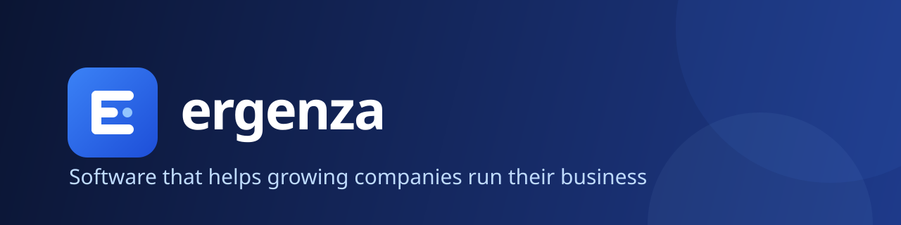

  

## About Ergenza

Ergenza is a software company. We build products that help growing companies run their business: simple to start, configurable instead of custom-coded, and ready for teams in more than one country.

## Ergenza HR and payroll

HR and payroll for teams hiring across countries. One employee record runs core HR, leave, attendance and payroll, in each team's currency and language. Tax rates and statutory rules are settings your team edits, not code.

| | |
|---|---|
| **Core HR** | Employee records, org structure, documents, self-service |
| **Time** | Leave, attendance and approval workflows |
| **Payroll** | Multi-currency payroll with tenant-editable statutory settings |
| **Talent** | Recruitment, performance, learning and engagement surveys |
| **Platform** | Multi-tenant, role-based access, English · Français · العربية |
| **Deployment** | Our cloud, or on-premises for Enterprise |

Status: **early access**, launching soon at **[ergenza.com](https://ergenza.com)**.

Our product source code is private. This page is Ergenza's public profile.
